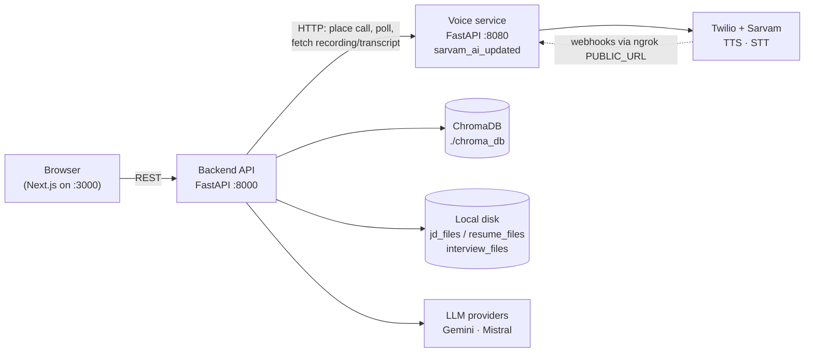
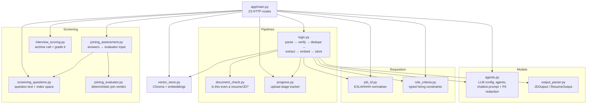
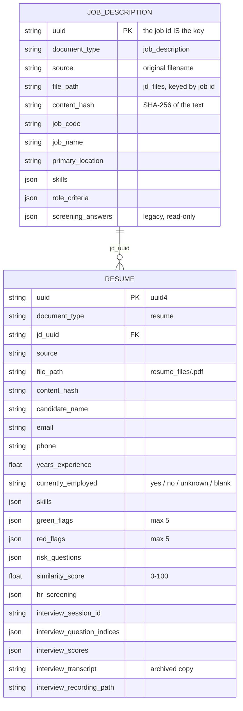
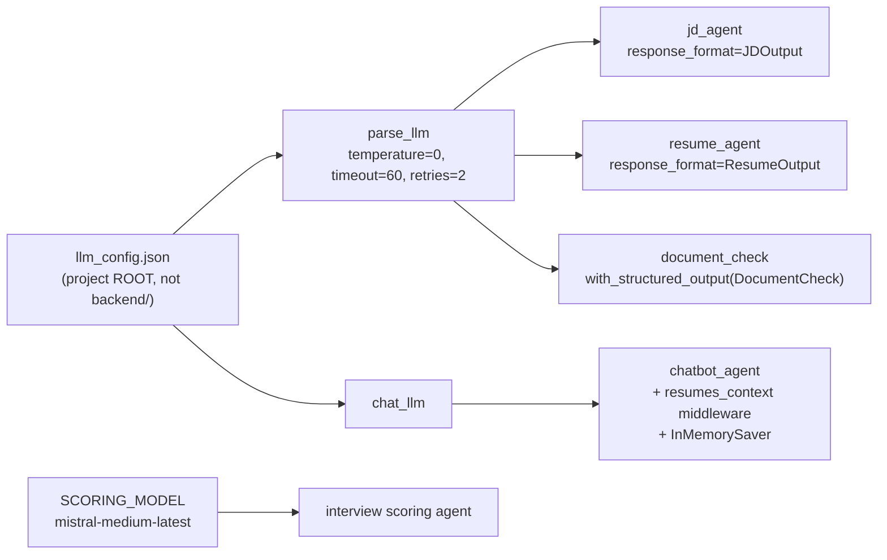
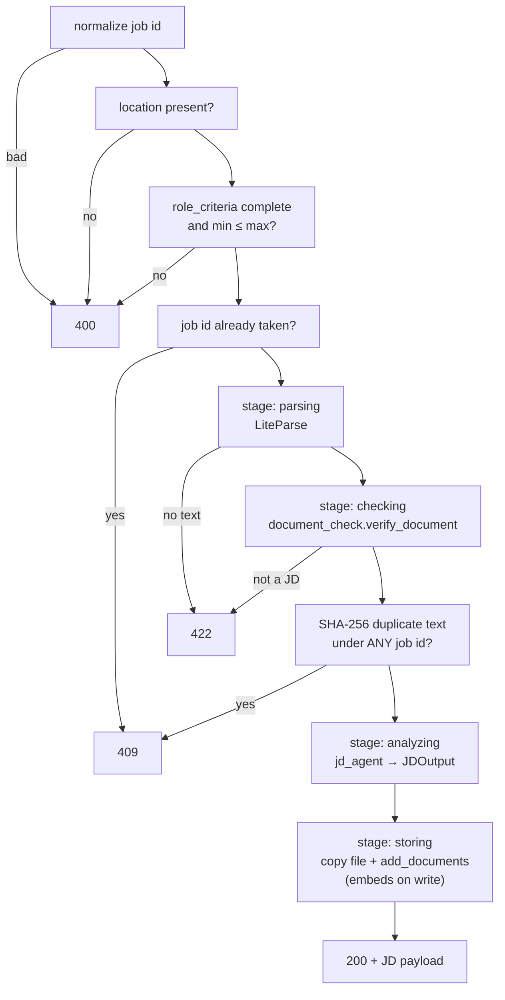
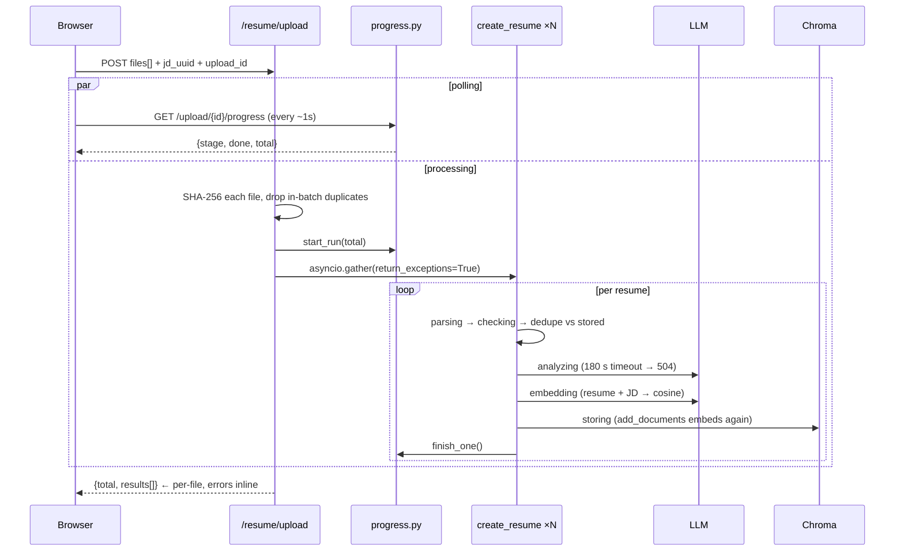
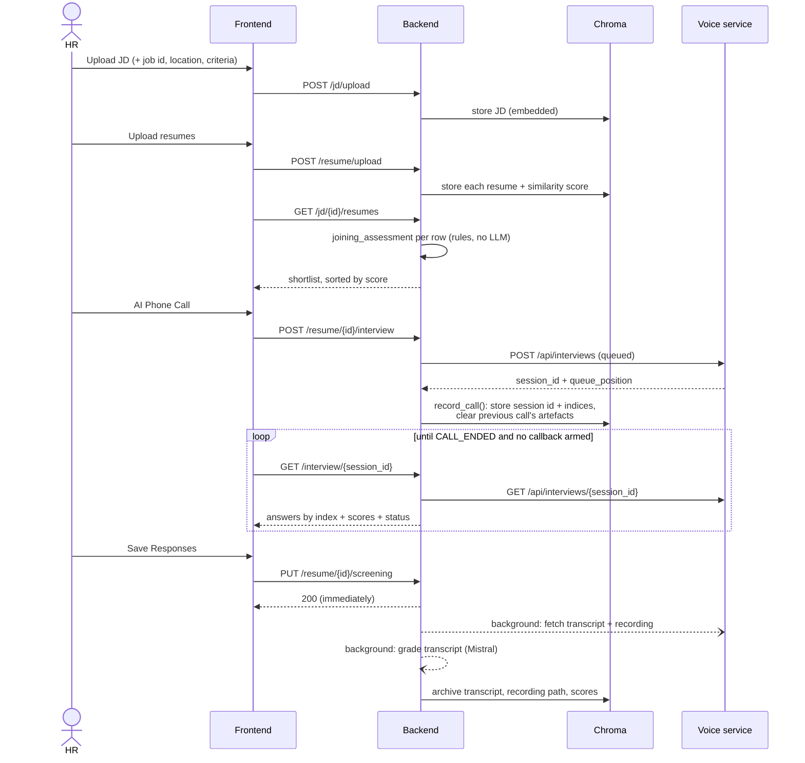
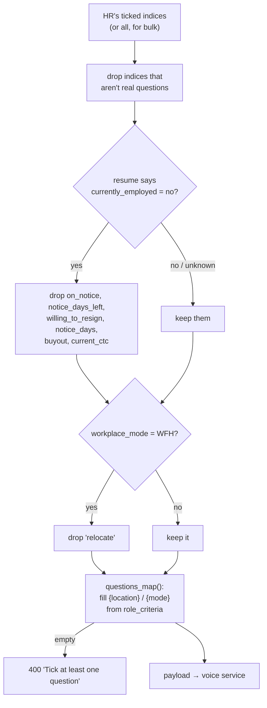
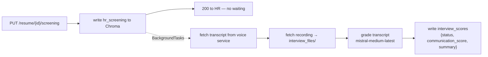

# TalentAI — Backend

FastAPI service on **port 8000**. It owns every candidate, every requisition and
every artefact the product produces. It is the only thing that talks to the
vector store, to the parsing/extraction LLMs, and to the voice service.

- Code: `backend/`
- Entry point: `backend/app/main.py` (`uvicorn app.main:app`)
- Must be started **from inside `backend/`** — `chroma_db/`, `resume_files/`,
  `jd_files/` and `interview_files/` are relative paths.
- Companion doc: `backend/ARCHITECTURE.md` (design rationale, kept by the team).
  Where the two disagree, this file was written from the code on 2026-08-20.

---

## 1. Where it sits



The backend never calls Twilio and never touches the voice service's disk. It
reaches it only over `INTERVIEW_SERVICE_URL` (default `http://localhost:8080`),
so a dead voice service degrades exactly four endpoints and nothing else.

---

## 2. Stack

| Component | What is actually used | Where |
|---|---|---|
| Web framework | FastAPI 0.139.0, Uvicorn 0.51.0 | `app/main.py` |
| Validation | Pydantic 2.13.4 | `output_parser.py`, request models in `main.py` |
| LLM orchestration | LangChain 1.3.13 `create_agent`, LangGraph 1.2.9 | `agents.py` |
| Extraction model | **configurable** — `activeParseModel`, currently `gemini-3.6-flash` | `llm_config.json` |
| Chat model | **configurable** — `activeChatModel`, currently `gemini-3.6-flash` | `llm_config.json` |
| Call grading model | **pinned** — `mistral-medium-latest` (`SCORING_MODEL`) | `interview_scoring.py` |
| Embeddings | **Google `gemini-embedding-2-preview`** | `vector_store.py` |
| Vector DB | Chroma (via `langchain-chroma`), embedded, on-disk | `./chroma_db` |
| Document parsing | LiteParse 2.5.1 | `logic.py` |
| Chat memory | LangGraph `InMemorySaver` — lost on restart | `agents.py` |

> The embeddings are Google's, not Mistral's. `ARCHITECTURE.md` still says
> MistralAI — that line is stale. Mistral is now used for exactly one thing:
> grading the phone call, deliberately pinned so switching the chat provider
> cannot move scores recruiters are comparing candidates on.

---

## 3. Module map



Every module except `main.py` and `vector_store.py` has a `demo()` /
`__main__` self-check that runs with plain `python3 <file>.py`.

---

## 4. Data model

### 4.1 One Chroma collection, two document types

There is **no relational database**. Everything lives in a single Chroma
collection called `job_descriptions`, and rows are told apart by a
`document_type` metadata field.



Consequences worth knowing:

- **The job id is the primary key.** Changing it is a document *move*
  (`rekey_jd`), not an update — the JD is re-added under the new key and every
  resume's `jd_uuid` is repointed. The new key is written first and the old one
  dropped last, so a mid-flight failure leaves the JD reachable at the old id.
- Chroma metadata is only safe with scalars, so every list/dict is stored as a
  **JSON string** and parsed on read.
- `page_content` is the full document text (what gets embedded).
- Deleting a JD deletes its resumes **first**, then their files, then the JD —
  order chosen so a failure can never orphan a resume.

### 4.2 What is *not* in the database

| Thing | Where it lives | Why |
|---|---|---|
| `joining_assessment` | computed on every read of `/jd/{id}/resumes` | pure function of the row; a rule change must never leave a stale verdict cached |
| The shortlist decision | derived in the **frontend** | see `frontend.md` §6 |
| Chat history | LangGraph `InMemorySaver`, per `thread_id` | dev-grade; lost on restart |
| Upload progress | process-local dict in `progress.py`, 15-min TTL | correct for one uvicorn worker only |
| Call sessions, transcripts, recordings | the voice service's own folder | backend keeps an archived copy on Save Responses |

### 4.3 Files on disk (all relative to `backend/`)

| Directory | Contents | Keyed by |
|---|---|---|
| `chroma_db/` | the vector store | — |
| `jd_files/` | original JD postings | job id |
| `resume_files/` | original CVs | resume uuid |
| `interview_files/` | archived call recordings | resume uuid |

---

## 5. The LLM layer



- `llm_config.json` sits in the **project root**, one level above `backend/`.
  Editing it through `POST /api/config/llm` calls `reload_llm_agents()`, which
  rebuilds every agent in place — no restart.
- If the active provider has no API key, the code silently falls back to Gemini
  from `GEMINI_API_KEY`.
- Structured output is enforced by Pydantic schemas, so a malformed LLM reply
  fails as a validation error rather than becoming a candidate.

### Structured schemas (`output_parser.py`)

```python
class JDOutput(BaseModel):
    skills: list[str]
    text: str                     # complete original JD text

class ResumeOutput(BaseModel):
    name: str
    email: str
    phone: str
    skills: list[str]
    years_experience: float       # internships counted IN FULL
    currently_employed: Literal["yes", "no", "unknown"]
    summary: str
    green_flags: list[str]        # 1–5, trimmed to MAX_FLAGS=5 in code
    red_flags: list[str]          # 1–5, trimmed to MAX_FLAGS=5 in code
    risk_questions: list[str]     # gaps / job hopping, ≤5, may be empty
    text: str                     # complete original resume text
```

`currently_employed` uses the literal `"unknown"` rather than `""` because some
providers reject an empty string as a JSON-schema enum member and fail the whole
request.

### Chatbot prompt safety (`agents.py`)

The chatbot's context is built by a `@dynamic_prompt` middleware:

1. Load resumes — one candidate if `resume_uuid` is given, otherwise all.
2. **Redact PII in code**, not by asking the model: emails via regex, and the
   candidate's phone number matched even when it is printed with spaces, dots,
   dashes or brackets.
3. Prepend a system prompt that scopes the assistant to hiring, forbids
   answering off-topic questions, and forbids revealing contact details.

Defense in depth: the prompt rule is the second line, the redaction is the first.

---

## 6. API reference

23 routes. Everything returns JSON unless noted. **CORS is wide open
(`allow_origins=["*"]`) and there is no authentication on any endpoint** — the
login screen is client-side only (see `frontend.md` §9).

### 6.1 Health & LLM configuration

| Method | Path | Body / params | Returns |
|---|---|---|---|
| `GET` | `/` | — | `{"message": "Resume Screening API is running"}` |
| `GET` | `/api/config/llm` | — | the whole `llm_config.json` |
| `POST` | `/api/config/llm` | `{providers: [...]}` | saved config; **400** if `providers` missing. Rebuilds all agents |
| `POST` | `/api/config/llm/active` | `{activeParseProvider, activeParseModel, activeChatProvider, activeChatModel}` | saved config |
| `DELETE` | `/api/config/llm/{provider_id}` | — | saved config; clears `active*` if they pointed at the deleted provider |

### 6.2 Job descriptions

#### `POST /jd/upload` — multipart

| Field | Required | Notes |
|---|---|---|
| `file` | ✅ | PDF/DOCX/PPT — the posting |
| `job_id` | ✅ | 6 digits or `EXL######`; normalised by `job_id.py` |
| `primary_location` | ✅ | non-empty |
| `job_name` | — | human title |
| `role_criteria` | ✅ in practice | JSON: `min_budget`/`max_budget` (lakhs), `min_notice`/`max_notice` (days), `workplace_mode` ∈ WFO/WFH/Hybrid, `buyout_offered` ∈ yes/no |
| `upload_id` | — | browser-minted id for progress polling |

Validation order is deliberate — **everything cheap happens before anything
expensive**:



#### The rest

| Method | Path | Notes |
|---|---|---|
| `GET` | `/jds` | Every JD + `resume_count`, sorted **most-screened first**. Includes `has_file`, `role_criteria`, legacy `screening_answers` |
| `GET` | `/jd/{jd_uuid}` | One JD, plus its full `text` |
| `GET` | `/jd/{jd_uuid}/download` | Original posting, `Content-Disposition: inline` → opens in a tab. **404** when `file_path` is absent (JDs stored before files were kept) |
| `PUT` | `/jd/{jd_uuid}/info` | Body may carry `primary_location`, `job_name`, `role_criteria`, `job_id`. Sending `role_criteria` **replaces** the set and must be complete. Sending a different `job_id` **re-keys** and returns `{jd_uuid, previous_jd_uuid, moved_resumes}` — callers must use the returned id |
| `DELETE` | `/jd/{jd_uuid}` | Deletes the JD, its resumes, and every stored file. Returns `deleted_resumes` |
| `GET` | `/jd/{jd_uuid}/resumes` | The shortlist: every resume, **sorted by `similarity_score` desc**, each with a freshly computed `joining_assessment` |

### 6.3 Resumes

| Method | Path | Notes |
|---|---|---|
| `POST` | `/resume/upload` | multipart `files[]` + `jd_uuid` + optional `upload_id`. **Max 10 per batch** (`MAX_RESUMES_PER_BATCH`) |
| `GET` | `/resume/{resume_uuid}/download` | Original CV, inline. 404 if the file was not kept |
| `DELETE` | `/resume/{resume_uuid}` | Removes the row and the file |
| `PUT` | `/resume/{resume_uuid}/screening` | Saves `{responses, selected_questions, comment, decision, heard}`. **Schedules a background task** that archives + grades the call (§7.3) |
| `GET` | `/upload/{upload_id}/progress` | `{total, done, stage}` or `{}`. **Never an error** — a missed poll must not look like a failed upload |

The resume batch is the only genuinely parallel path:



`return_exceptions=True` is the point: one unreadable CV becomes one `error`
entry in `results`, and the other nine still land.

### 6.4 AI phone screening

| Method | Path | Notes |
|---|---|---|
| `POST` | `/resume/{resume_uuid}/interview` | `{question_indices: int[], phone?: string, speaker?: string}` → `{session_id, phone, question_indices, queue_position}` |
| `POST` | `/interviews/bulk` | `{resume_uuids: string[], question_indices?: int[], speaker?: string}`. Empty indices = every flow question. Returns per-resume results, undialable candidates listed as `error` rather than failing the batch |
| `GET` | `/interviews/active` | Every call the voice service still has in hand, `{sessions: {session_id: {call_status, queue_position}}}`. One request covers a whole table. Returns `{}` rather than a 502 when the voice service is down |
| `GET` | `/interview/{session_id}?indices=&resume_uuid=` | Poll. Returns `answers` **keyed by screening-question index** (each `{transcript, status, value, volunteered}`), plus `scores`, `call_status`, `queue_position`, `call_error`, `gate_reason`, `callback_at` |
| `GET` | `/resume/{resume_uuid}/interview/recording` | `audio/wav`. Archived copy first, live service second. 404 while Twilio is still processing |
| `GET` | `/resume/{resume_uuid}/interview/transcript` | The `.txt`, as an attachment named after the candidate |
| `GET` | `/interview/voices` | The Bulbul voices HR can pick from — `{voices: [{id, gender, tone}], default}`, proxied from the voice service's roster (`sarvam_ai_updated/voices.py`) |
| `GET` | `/interview/voices/{speaker}/preview` | `audio/wav` of that voice reading the call's opening line. Synthesized once per voice and cached on the voice service's disk |

`volunteered` marks an answer to a question that was **never put**: the
candidate said it while answering a different one, and the voice service filed
it against the question it actually answers (`record_volunteered`, driven by
`agent.extract_all` — one call reads an utterance against every field still
open, so all of "yes and I'm on notice, 20 days left, and they do buyouts"
lands). It fills the form field like any other answer —
that is the point, the information was given — and the modal labels the sentence
*Mentioned unprompted* so HR reads it before saving.

**The call then does not ask that question again.** `questionnaire.route` steps
over it the same way it steps over a question HR unticked, with one difference:
an unticked question follows `skip_to` (there is no answer to route on), a
volunteered one follows `next()` with the answer they gave — so "yes, I'm
serving notice", volunteered, still takes the notice branch.

Two rules bound it:

- **A volunteered answer can move the call forward and nothing else.** If
  routing it would end the call — a reschedule, a goodbye — the question is put
  properly instead, and the ending has to come from the answer to it. An
  extraction that understood nothing (`repeat`) is asked for the same reason.
  The guard is enforced in `route`, not by the answers happening to be harmless:
  no question ends the call today (below), but it is what makes restoring one
  safe.
- **An asked answer always outranks an overheard one.** The harvest never
  overwrites an existing entry, and asking the question later replaces the
  volunteered one wholesale.

The harvest runs off the reply path, so it costs the call no latency.
`VOLUNTEERED_HARVEST=0` turns the whole thing off, and every question on the
script gets asked as before.

**Expected CTC is read against current CTC.** "I'm expecting a 30% hike" is the
commonest answer to the question and carries no salary figure at all — the only
number in it is 30 — so extraction used to fail and the node re-asked until the
candidate gave up and named a number. `agent._fast_relative_money` applies the
percentage to whatever they already said they earn (`_current_ctc`, read off
`answers.current_ctc.extracted.value`), and the same figure is given to the LLM
prompt so wordier forms ("double what I make now") resolve too. An explicit
figure beside the percentage still wins — `_fast_money` runs first — and with no
current CTC on the session there is nothing to apply, so the question is
re-asked, correctly. The ack states the computed figure ("about 26 lakhs") so a
wrong reading is correctable on the call rather than in the form afterwards.

`/interviews/active` proxies the voice service's `/api/interviews/active`,
which reads `_call_done_events` — the set a session joins when it is enqueued
and leaves when the call reaches a terminal status. So it lists exactly the
queued, ringing and connected calls, and a session that was created but never
dialed is not among them. `queue_position` 0 means "not waiting": that one is on
the phone now. Both routes are declared **before** their `{session_id}` sibling,
or the parameterised route reads "active" as a session id and 404s.

`speaker` is the voice the call is spoken in, picked in the UI and remembered
per browser (`selectedVoice()` in `lib/api.ts`), so it reaches both the single
and bulk paths without being a property of the candidate. Empty means the voice
service's `SARVAM_TTS_SPEAKER`. An unrecognised name is rejected with a 400 when
the call is *placed* — Sarvam only refuses it during the TTS handshake, which is
after the candidate has picked up.


### 6.5 Chatbot

`GET /chatbot?user_input=…&thread_id=default&resume_uuid=`

- `resume_uuid` empty → context is **every** resume (dashboard comparison mode).
- `resume_uuid` set → that candidate plus their JD.
- `thread_id` selects the LangGraph conversation; history is in memory only.
- Provider failures are translated into readable **502**s that name the provider
  and distinguish a rejected key from an exhausted quota.

---

## 7. Core flows

### 7.1 The whole product, end to end



### 7.2 Which questions get asked — decided *before* dialling

`prepare_call()` in `app/main.py` is the single place this is decided. The voice
service asks exactly the keys it is handed and steps over everything else, so
the **key set is the script**.



Unknown employment asks everything on purpose: a wrong skip loses an answer, a
wrong ask costs twenty seconds.

### 7.3 Save Responses → archive and grade



Every step is best-effort and independent. HR's save is already committed, so a
voice service that is down or an LLM that errors is logged and leaves the
previous value in place — it can never turn a saved screening into an error.

### 7.4 Screening-question index space

Responses are keyed by integer index, and the ranges are **reserved, never
reused** — so an answer saved last month still resolves to the question it was
actually recorded against.

| Range | Set | Status |
|---|---|---|
| `0–9` | `CALL_QUESTIONS` — the original flat list | legacy, resolvable only |
| `100–199` | per-candidate `risk_questions` (`RISK_INDEX_BASE`) | live |
| `200–299` | `LEGACY_FLOW_QUESTIONS` — the first conditional flow | legacy, resolvable only |
| `300+` | `FLOW_QUESTIONS` — the live flow (`FLOW_INDEX_BASE`) | **live** |

`FLOW_QUESTIONS` is **append-only**. `INDEX` / `KEY_AT` are derived from it, and
the list is index-aligned with `frontend/lib/screening-flow.ts`. Inserting a
question rather than appending silently re-points every stored answer after it.

The voice service returns answers keyed by **flow key** (`"relocate"`), and
`GET /interview/{id}` maps key → index through `INDEX`. A numeric key means a
session written before that change and is mapped positionally against the
indices the call actually went out with.

---

## 8. Scoring and decisions

### 8.1 Resume ↔ JD similarity

```
similarity = (A · B) / (‖A‖ × ‖B‖)
score      = max(0, min(1, similarity)) × 100      # rounded to 2 dp
```

Both texts are embedded with `gemini-embedding-2-preview`
(`logic.py: calculate_similarity`). This is the number shown as **Resume score**
and the sort order of every shortlist.

### 8.2 Joining likelihood — deliberately **not** an LLM

`joining_evaluator.py` applies fixed rules to the screening answers, so the same
answers always give the same category and the whole thing is testable offline.

| Criterion | Severity | Flags when |
|---|---|---|
| `location` | hard | not at the primary location, role isn't remote, won't relocate |
| `work_model` | hard | not comfortable with the required mode |
| `ctc` | hard / soft | expected CTC over `max_budget` — **hard** if they say it is not negotiable, **soft** if negotiable or never asked |
| `notice` | hard | notice over `max_notice` with no buyout (N/A if unemployed) |
| `documents` | soft | verification documents not ready |
| `competing_offers` | soft | advanced-stage competing offer |

**Any hard flag → LOW. Any soft flag → MEDIUM. None → HIGH.** A candidate who
rules themselves out is `WITHDRAWN`, kept out of LOW on purpose.

**No question ends the call.** Three answers used to hang up mid-screening —
won't relocate, won't resign (or "maybe"), and not interested. None does any
more: every applicable question is asked and every answer recorded, whatever is
said. Two of the three are unaffected in grading, because the table above reads
the *answer* and not the ending: won't relocate is still LOW on the `location`
hard flag, not interested is still `WITHDRAWN`.

`willing_to_resign` is the exception. `ScreeningAnswers` has no field for it, so
the call ending was its only expression — a candidate who says they will not
resign now grades **HIGH**. The answer is still on the transcript and in the HR
form; nothing scores it. Adding a `resign` criterion would change how candidates
are graded, so it is a product call rather than a mechanical fix.

Two rules that matter more than they look:

- **An unscreened candidate gets no verdict at all.** Every field is optional
  and unknown means "no flag", so an empty screening would otherwise produce
  zero flags and land on HIGH — "we asked nothing, therefore they are very
  likely to join".
- **Lakhs → rupees.** `max_budget` is in lakhs; a spoken CTC parses to rupees.
  `joining_assessment.py` is one of three places those units meet. Drop the
  ×100 000 and nothing is ever over budget.

It **decides nothing**. Nothing in the shortlist decision reads it; it is
evidence for the Override dropdown.

### 8.3 Comprehensive (call) score

Graded from the transcript by `mistral-medium-latest` into
`{status, communication_score: 0-100, summary}`. Stored on the resume as
`interview_scores`.

> The **stored field is `communication_score`**; the label the UI shows is
> **"Comprehensive"**. Don't rename the field — it is on the wire from the
> grader to the stored metadata and out to saved transcripts.

### 8.4 What the backend does *not* decide

`shortlist_decision` is **not** a backend concept. The backend stores HR's
saved decision inside `hr_screening` and nothing else. The pool-relative
Selected-for-R1 / On-Hold call is made in the browser — see `frontend.md` §6.

---

## 9. Guard rails

### 9.1 Is this file even a resume / a JD? (`document_check.py`)

Runs **straight after parsing, before anything expensive** — no extraction, no
embedding, no file copy, nothing stored.

- Classifies the first 3 000 characters into
  `Literal["resume", "job_description", "other"]` via structured output.
- Raises **422** with a message written for HR: what the file looks like
  instead, and what to upload.
- **Fails open.** A classifier that errors or times out lets the upload through:
  a bad row can be deleted; a classifier outage that blocks every upload stops
  the hiring work.
- Documents under 200 characters skip the check.

### 9.2 Duplicate detection

| Function | Applies to | Rule |
|---|---|---|
| `reject_duplicate_jd()` | JDs | identical text under **any** job id and **any** location → 409. One posting is one requisition |
| `reject_duplicate()` | resumes | identical text **within the same `jd_uuid`** → 409. The same person may apply for two roles |
| in-batch digest set | resumes | byte-identical files in one upload are dropped before the parallel tasks start, which would otherwise race past the stored-hash check |

Comparison is **exact text**, so a one-character change is a new document. Wrong
in the safe direction: a missed duplicate costs a stray row, a wrong reject
blocks real work.

### 9.3 Phone number normalisation

`CandidatePhone` (a pydantic validator) turns whatever was printed on the CV
into E.164, assuming **+91**, and rejects anything undialable with a 400 before
a call is placed.

### 9.4 Everything blocking goes through a thread

LiteParse, the classifier, the LLM call and `add_documents` all block. On the
event loop they starve the progress endpoint itself — the browser polls, FastAPI
cannot answer until the upload finishes, and the bar sits at its opening label
for the whole wait. `create_jd` shipped with exactly that bug once.

---

## 10. Error conventions

| Status | Means | Examples |
|---|---|---|
| **400** | The request is wrong and the caller can fix it | malformed job id, missing location, incomplete `role_criteria`, undialable phone, no questions ticked, >10 resumes |
| **404** | The thing isn't there | unknown uuid, JD/resume file never kept, no call placed yet, recording still processing |
| **409** | Conflict with something already stored | job id taken, duplicate JD text, duplicate resume under this JD |
| **422** | The file was read fine — it just isn't what you said it was | offer letter in the JD slot, payslip in the resume batch, no extractable text |
| **502** | A dependency failed, named in the message | voice service down, chat provider rejected the key or out of quota |
| **504** | The extraction LLM took longer than 180 s | one slow resume |

The 422 wording is deliberate: "was not analyzed", not "could not be read". The
file *was* read.

---

## 11. Configuration

| Variable | Default | Used by |
|---|---|---|
| `GEMINI_API_KEY` / `GOOGLE_API_KEY` | — | extraction, chat, **embeddings** |
| `MISTRAL_API_KEY` | — | call grading |
| `INTERVIEW_SERVICE_URL` | `http://localhost:8080` | every voice-service call |
| `SCORING_MODEL` | `mistral-medium-latest` | `interview_scoring.py` |

Plus `llm_config.json` in the **project root** for provider keys and active
models, editable through the API at runtime.

Timeouts: extraction **180 s**, place-calls **240 s**, artefact fetch **60 s**,
poll **30 s**.

---

## 12. Known limits

These are marked in the source with `ponytail:` comments, so they can be found
with `grep -rn "ponytail:" backend/`.

| Limit | Where | Matters when |
|---|---|---|
| No authentication, CORS `*` | `app/main.py` | anything beyond a trusted network |
| Upload progress is a process-local dict | `progress.py` | running `uvicorn --workers N` |
| Job-id uniqueness is read-then-write | `logic.py` | two uploads of one id in the same instant |
| Same-text-different-bytes files in one batch can race | `logic.py` | rare |
| Local disk for files | `logic.py` | more than one box |
| Recording is held whole in memory | `app/main.py` | very long calls |
| Chat history in `InMemorySaver` | `agents.py` | restarts lose conversations |
| `+91` assumed for phone numbers | `app/main.py` | non-India requisitions |

---

## 13. Running the checks

```bash
cd backend && for f in job_id role_criteria screening_questions document_check progress joining_assessment joining_evaluator; do .venv/bin/python $f.py; done
```

No test framework — each module asserts its own behaviour under `__main__`.
