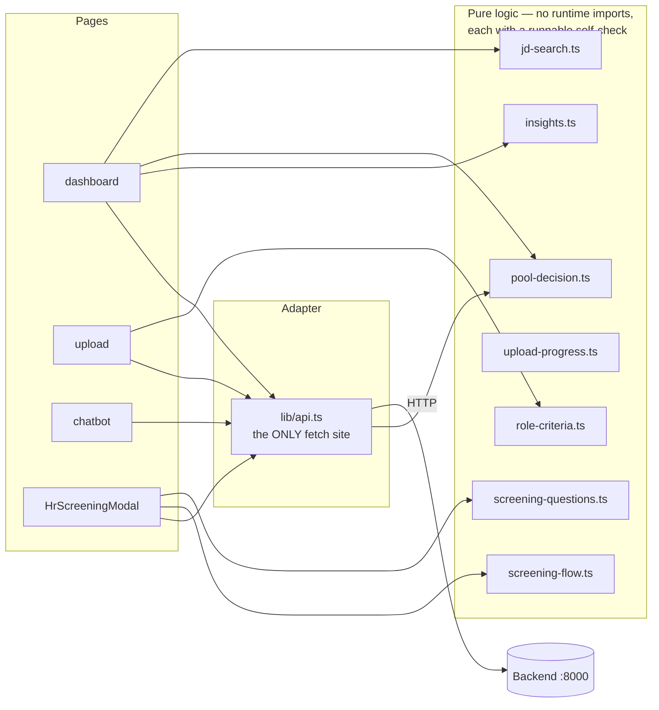
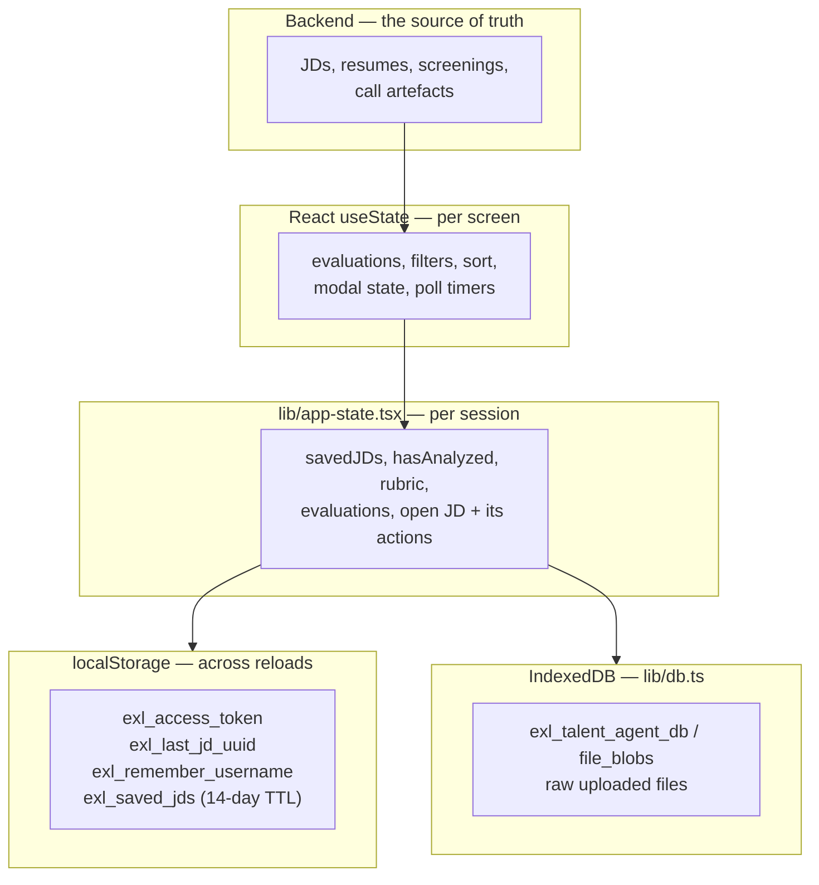
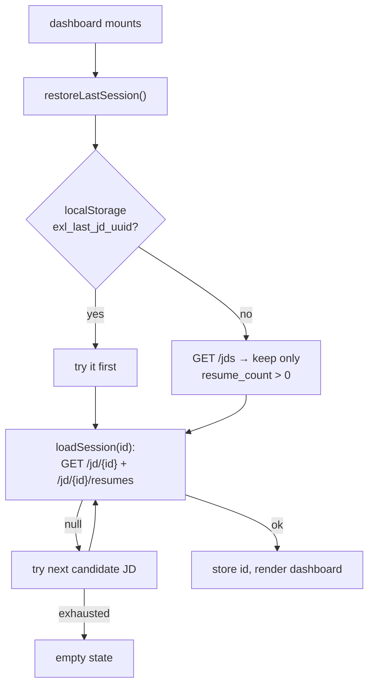
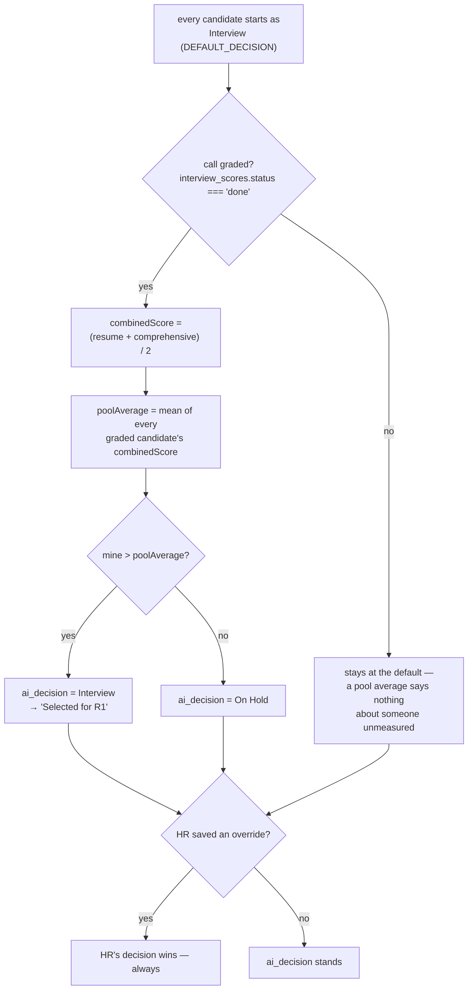
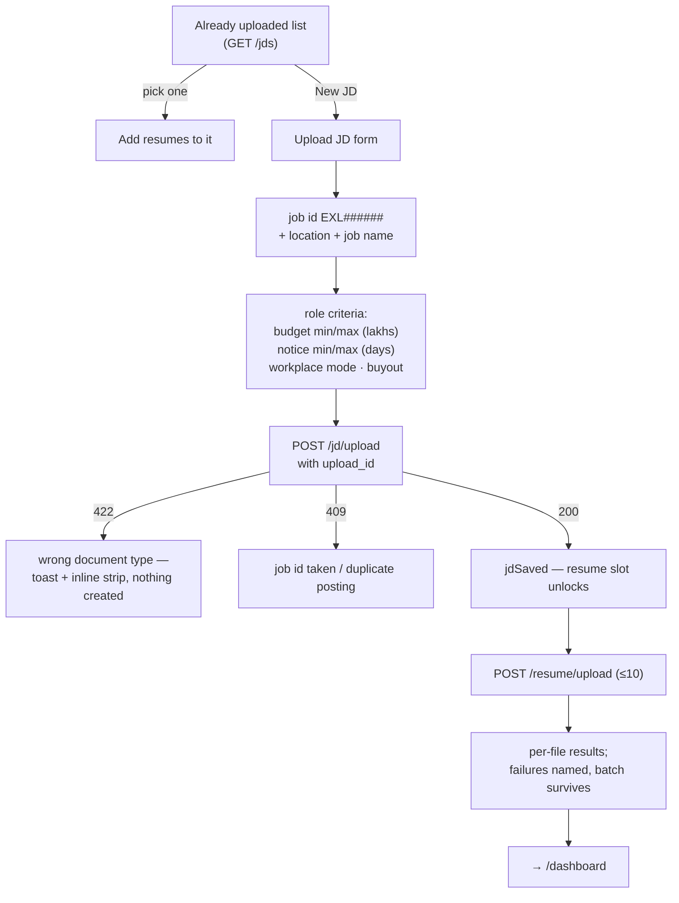
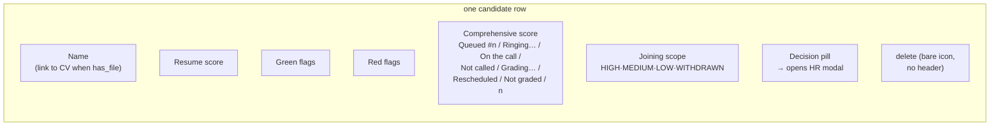

# TalentAI — Frontend

Next.js 16 (App Router) + React 19, **every component a client component**, on
**port 3000**. Tailwind v4 for styling, `lucide-react` for icons, `xlsx` for the
Excel export. No state library, no data-fetching library, no component library.

- Code: `frontend/`
- Companion doc: `frontend/AGENTS.md` — the working rulebook (why each screen
  looks the way it does, what must not be "fixed"). This file is the
  architecture; that one is the reasoning.

---

## 1. The one rule that explains the codebase

> **This UI was not written against this backend.** It was built for a different
> API, and `lib/api.ts` is the adapter that bridges the two.

Everything follows from that:

- **No component ever calls `fetch` directly.** Every backend call goes through
  `lib/api.ts`.
- When the UI wants a shape the backend does not have, the translation belongs
  in `api.ts` — not in the page.
- Some concepts (the shortlist decision, the combined score) exist **only** in
  the frontend. The backend has no opinion on them.



---

## 2. Routes

| Route | File | Purpose |
|---|---|---|
| `/` | `app/page.tsx` | server redirect → `/dashboard` |
| `/login` | `app/login/page.tsx` | sign-in screen |
| `/dashboard` | `app/(app)/dashboard/page.tsx` | the shortlist — the heart of the app |
| `/analysis` | `app/(app)/analysis/page.tsx` | Collective analysis — the cohort as one set of figures |
| `/upload` | `app/(app)/upload/page.tsx` | create/edit requisitions, add resumes |
| `/chatbot` | `app/(app)/chatbot/page.tsx` | "Your Assistant" — cross-candidate Q&A |
| `/test` | `app/test/page.tsx` | a click-test scratch page |

`app/(app)/layout.tsx` is the route group that wraps the four real screens: it
checks the auth token, mounts `<Header/>` and `<AppStateProvider>`, and provides
the single scrolling `<main>` (which is why the dashboard's sticky bar uses
`top-0`).

---

## 3. How the frontend finds the backend

```text
const API_BASE =
  process.env.NEXT_PUBLIC_API_BASE_URL ||
  (browser
    ? hostname matches /^\d+-/  ?  `https://${hostname.replace(/^\d+-/, "8000-")}`   // cloudspace
                                :  `http://${hostname}:8000`                          // local/LAN
    : "http://localhost:8000");
```

`frontend/.env.local` exists but has **everything commented out on purpose**.
Hardcoding `http://localhost:8000` breaks the browser on a remote host — the
browser's `localhost` is not the backend — and produces `TypeError: Failed to
fetch`. Deriving it from the page's own hostname is what makes local, LAN and
cloudspace all work with no configuration.

---

## 4. State: what lives where

There is no Redux/Zustand/React Query. State is deliberately spread across four
places, each chosen for its lifetime:



- **`lib/app-state.tsx`** — React context holding the locally remembered JD
  list, the active rubric and `hasAnalyzed` (which unlocks the Assistant nav
  link). Saved JDs expire after **14 days** and are pruned on read.
- **Which requisition is open lives there too**, with the four actions that
  change it: `jds` / `selectedJd` / `refreshJds` / `openJd` / `openLastJd` /
  `uploadMore`, plus the upload's in-flight status. They were the dashboard's
  own `useState` until Collective analysis started showing the same JD bar
  (`components/JdBar.tsx`). They all end in `setEvaluations`, so a second copy
  of "switch JD" or "add resumes" is how one screen ends up listing candidates
  the other has already replaced. A page keeps only its own spinner flags.
- **`lib/db.ts`** — a tiny IndexedDB wrapper (`storeFileBlob` / `getFileBlob` /
  `deleteFileBlob`) so a re-visited upload screen can still show the actual file
  the user picked, which `localStorage` cannot hold.
- **`exl_last_jd_uuid`** is what makes the dashboard survive a reload.

### Session restore



The fallback matters: the stored id can point at a JD that was deleted or
re-keyed. Trying only that id left the dashboard empty even with other
screenings sitting in the database.

---

## 5. `lib/api.ts` — the adapter

One file, ~1 000 lines, the only place `fetch` appears.

### 5.1 The two shapes

`BackendResume` is what `/jd/{id}/resumes` returns. `CandidateEvaluation` is
what the UI renders. `toEvaluation()` maps one to the other and **derives** the
fields the backend does not have:

| UI field | Derived how |
|---|---|
| `matched_mandatory_skills` | JD skills ∩ resume skills, case-insensitive |
| `missing_mandatory_skills` | JD skills − resume skills |
| `Transferable_skills` | resume skills − JD skills |
| `overall_match_score` | `Math.round(similarity_score)` |
| `shortlist_decision` | `DEFAULT_DECISION` ("Interview"), then overridden by HR's saved decision, then by `applyPoolDecisions` |
| `resume_url` | built from `has_file` — `undefined` means the UI renders plain text instead of a dead link |
| `interview_recording_url` / `interview_transcript_url` | only when `interview_session_id` exists |
| `reasoning` | the LLM summary, or a generated sentence when there is none |

### 5.2 Naming rules that must not be broken

| Stored value | What HR reads | Translator |
|---|---|---|
| `"Interview"` | **"Selected for R1"** | `decisionLabel()` in `lib/api.ts` |
| `communication_score` | **"Comprehensive"** | the four render sites (`AGENTS.md` §lib/api.ts) |

Never rename the stored values: backend metadata, filters, the pipeline chart
and the Excel export all key off `"Interview"`, and `communication_score` is on
the wire from the grader through to saved transcripts.

### 5.3 The full API surface

| Group | Functions |
|---|---|
| JD | `uploadJD`, `loadJD`, `listJDs`, `saveJDInfo`, `deleteJD`, `jdFileUrl`, `extractJDSkills` |
| Resumes | `uploadResumesForJD`, `deleteResume`, `describeFailures` |
| Session | `loadSession`, `restoreLastSession` |
| Screening | `saveScreening` |
| Calls | `startPhoneInterview`, `startBulkInterviews`, `getPhoneInterview`, `activeInterviews`, `interviewUrls`, `CALL_ENDED` |
| Chat | `chatWithAI` |
| Export | `downloadEvaluationsExcel` |
| Settings | `getLlmConfig`, `saveLlmConfig`, `deleteLlmProvider` |
| Labels | `decisionLabel`, `stageLabel` |

---

## 6. Decisions are made in the browser

This is the single biggest thing to know about this frontend. **The backend has
no `shortlist_decision`.** It stores whatever HR saved inside `hr_screening` and
nothing more.



Implemented in `lib/pool-decision.ts` (`combinedScore`, `applyPoolDecisions`),
applied inside `loadSession()` so every consumer sees the same answer.

Three properties worth stating plainly:

- **It is relative, so it is unstable by design.** Grading one more call moves
  the average and can move other rows across the line.
- **A single graded candidate *is* the average**, so they land On Hold until
  there is someone to be better than.
- **It never overrides HR**, and it never touches an ungraded candidate.

The score-based auto-decision that used to live here (≥75 Interview, ≥60 On
Hold) was removed: it auto-rejected people on a heuristic number and — because
the modal only opened for "Interview" — locked HR out of the very form they
would have used to reverse it.

---

## 7. Screen by screen

### 7.1 `/upload` — requisitions



- The job-id clash is caught **while typing**, against the JDs already on
  screen, and again by the backend on submit — which is what catches an id
  another recruiter claimed a minute ago.
- Every row links to the original posting, but **only when `has_file`** —
  otherwise it is a plain row with a tooltip, so it can never open a tab on a
  404. Same rule as `resume_url`.
- Editing a JD's job id **moves** it. `saveJDInfo()` returns the new id and
  callers must use the returned value from then on.

### 7.2 `/dashboard` — the shortlist

Top to bottom:

1. **Sticky bar** — `components/JdBar.tsx`, shared with `/analysis`: the JD
   switcher (`components/JdPicker.tsx`, searchable), an ⓘ that opens the JD
   itself, Add Resumes, and Export in Excel on the right. It carries its own
   progress bar and upload-failure notice, because both belong to the button
   that caused them. (The dashboard's *empty state* keeps its own inline copy of
   the switcher and Add Resumes: it returns early, before the bar renders, and
   centres its controls instead.)
2. **Stat tiles** — ready for HR screening, median match, scarce skills,
   flagged for risk.
3. **Pipeline bar** — Selected for R1 / On Hold / Rejected, each segment a filter.
4. **Skill cloud / chart** — every JD skill with `n/total` coverage, AND/OR
   filtering, scarce skills marked.
5. **Score distribution & experience mix** — two histograms; the left one
   toggles between **Resume** and **Comprehensive** views.
6. **Candidate table** — nine grid columns.



Every non-scored call state is **words, not a number**: never called, called but
rescheduled, graded. Rendering any of them as `0` or `—` would flatten a real
difference into "this candidate did badly".

**A call in progress shows in that same cell**, ahead of the score, because the
cell is empty until the call is graded anyway and the table is already wide.
Three states, since they mean different things to someone waiting on a result:
`Queued #n`, `Ringing…`, `On the call`. Calls go out strictly one at a time, so
at most one row in the table can read *On the call*. The dot beside them is
decoration — the words carry the state on their own.

The states come from **one** `activeInterviews()` poll for the whole table, not
one per called candidate, matched to rows by `interview_session_id`. It probes
once on arrival — so reloading the page mid-call still shows it — then every 5s
only while something is outstanding, and stops when the queue empties, so a
quiet dashboard makes no requests at all. It restarts when a batch is queued
(after the JD reload that puts the new session ids on the rows) and when the
screening modal closes, since a call may have been placed inside it.

Queue position is deliberately **not** kept in browser state. It was, and it went
stale the instant the call ahead finished — rows read "Queued #1" long after
they had been called, and a call placed from the modal showed nothing at all.

Filters compose and every one of them is individually removable from a single
"Filtered by" strip — decision, ready-for-screening, skill words, experience
range and the name search.

Two icons that point at different things on purpose: the **ⓘ** beside the JD
switcher opens the **JD**; the **👁** in front of a candidate's name opens
**that candidate's CV**.

### 7.2b `/analysis` — Collective analysis

The cohort read as one set of numbers rather than a list of people, in the nav
directly after the table it summarises. Every figure comes from
`lib/collective.ts` over the **whole** cohort — nothing here is narrowed by the
dashboard's search box or filters, which is the point of it being a separate
page rather than a card inside that one.

1. **Response analysis** — one **stacked column** per yes/no screening
   question (`StackedColumns`). Counts, not percentages: a cohort here is five or
   six people, so "100% said yes" off one answer is a sentence this data cannot
   support. Column height is the number who answered, the split sits inside it,
   and **yes sits on the baseline** because that is the edge a reader compares
   across columns. A question this cohort was never asked is absent rather than
   drawn as an empty column, which would read as "everybody said no".

   Three questions never appear, whatever the answers: `right_time`,
   `bgc_documents` and `still_interested` (`OFF_CHART` in `lib/collective.ts`).
   They are call hygiene, not signal — near enough everybody says yes, so they
   drew solid columns that crowded out the questions worth reading. They are
   still asked, recorded and shown in the HR form; this is a chart rule only.

   Colour is **emphasis, not identity**: yes wears the brand accent, no wears the
   neutral slate. Deliberately not green/red — "yes" is good news on *do you have
   the BGC documents* and bad news on *do you hold another offer*, and a palette
   that judged one would be lying about the other. Anything that is neither (the
   one question offering "maybe") takes amber and stacks last, because brand
   orange and status amber measure ΔE 2.5 under deutan simulation and must never
   share an edge.
2. **Salary expectation vs budget** — expected CTC in six bands
   cut from the data (`salaryBins`), with the requisition's own band on the same
   axis: bars **above the ceiling are amber**, and the marker under the chart
   names the offered band in slate, the colour of a reference rather than a
   verdict. Beside it, a three-row readout: what the role offers, how many are
   over the ceiling, and the median ask.
3. **Call effort** — call-length and dials-per-candidate histograms, only once a
   call exists.
4. **Mean, median and mode** — the three `MetricTable`s (call, criteria,
   compensation), each with its own `n`, because their denominators differ.

It reads the same `evaluations` as the dashboard and restores them the same way
(`openLastJd`), so it survives being opened first or reloaded, and it carries
the same sticky `JdBar` — so the JD can be switched, resumes added and the
screening exported from here without going back. Switching re-scopes every
figure on the page, because the selection itself is shared state.

The bar sits above the loading and empty states too: a requisition with nothing
screened against it yet is a place to work from rather than a dead end.

The page opens on a four-tile KPI row (candidates, screened by call, median ask,
above the ceiling) on the dashboard's own `grid-cols-2 lg:grid-cols-4 gap-3`, and
carries **no page title**: the switcher directly above already names the
requisition, which is why that block was taken off the dashboard too. Every bar
in the app — histogram and stacked column alike — is capped at **40px** so one
chart never reads as a wall of colour beside another of the same data.

### 7.3 The HR screening modal

The most stateful component in the app (`HrScreeningModal.tsx`).

A field filled from the call shows the sentence behind it, labelled **On the
call** — or **Mentioned unprompted** (amber) when the candidate was never asked
that question and answered it while answering another one. The call does not go
on to ask a question answered that way (`questionnaire.route`), so the amber
label is the only place that answer's provenance shows. The flag travels on
the saved `heard` string (`UNPROMPTED` / `unprompted()` in that file), because
"we did not ask this, they offered it" is worth keeping in the record, and a
parallel map would have to be threaded through the poll, the form state and the
save payload to say the same thing.

```mermaid
sequenceDiagram
    actor HR
    participant M as Modal
    participant API as Backend
    participant VS as Voice service

    HR->>M: click a decision pill
    M->>M: load saved responses, ticks, comment, heard
    M->>M: visibleFlow() — render only questions<br/>whose askIf passes on the answers so far

    opt AI phone call
        HR->>M: AI Phone Call
        M->>API: POST /resume/{id}/interview {question_indices}
        API-->>M: {session_id, indices, queue_position}
        loop adaptive polling
            M->>API: GET /interview/{session_id}
            API->>VS: GET /api/interviews/{id}
            API-->>M: answers by index + status + scores
            M->>M: fill fields; keep 'heard' verbatim
            Note over M: callback armed → keep polling<br/>at 5 s (30 s once ended)
            Note over M: ended + transcribed → stop<br/>(≤6 extra polls grace)
        end
    end

    HR->>M: Override decision + Save Responses
    M->>API: PUT /resume/{id}/screening
    API-->>M: 200
    M->>API: reload the JD's resumes
```

Key behaviours:

- **The flow is conditional.** `lib/screening-flow.ts` is a flat array of
  questions each carrying an `askIf` predicate; the modal re-evaluates them
  against the answers so far and renders only what applies.
- **`requires` vs `askIf`.** A rule knowable *before* the call (HR's ticks, the
  WFH rule, the employment gate) is a `requires` and is applied by the backend
  when it picks the key set. A rule that depends on an *answer* is an `askIf`
  and is evaluated live. Putting a pre-call rule in the live branch is a bug
  this project has already shipped once.
- **`heard` is kept alongside the parsed value.** A number field stores
  `400000`, a radio stores `yes` — the sentence that was parsed into it would
  otherwise vanish when the modal closed, making a mis-parse invisible.
- **A rescheduled callback runs on the same session** and fills the same
  answers, so `call_status: completed` is *not* the end of the screening. The
  modal keeps polling (slowly) while a callback is armed.
- **Reopening a form picks the call back up.** The read-back on open (which
  exists for a callback dialed hours later) also checks `call_status`: anything
  outside `CALL_ENDED`, or an armed `callback_at`, hands the session straight to
  the live poll. Without that, closing the form mid-call and reopening it gave
  one static snapshot — the rest of the call ran with nothing watching, and the
  answers only appeared on the *next* open. The call itself never depended on
  the browser; only the filling did.
- Closing the modal re-reads the JD's resumes, because a call placed inside it
  changes what the row knows. It does **not** stop the call, the Twilio
  recording or the transcript — all three are server-side. What a close costs is
  the unsaved form state, and `archive_and_score` (which only runs on Save).

### 7.4 `/chatbot` — Your Assistant

A thin screen: a message list, three starter questions, and `chatWithAI()` →
`GET /chatbot`. Answers render through `components/Markdown.tsx` (tables and
bullet lists, since the system prompt asks for them). The nav link is **locked
until something has been analyzed** (`hasAnalyzed` in app-state).

---

## 8. Pure-logic modules and their self-checks

These have **type-only imports on purpose**, so each runs under plain Node with
no bundler:

```bash
cd frontend && for f in screening-questions screening-flow upload-progress jd-search pool-decision; do node --experimental-strip-types lib/$f.check.ts; done
```

| Module | Owns |
|---|---|
| `screening-flow.ts` | the question list, `askIf`/`requires` predicates, `visibleFlow`, `callableFlow`, `parseNumericAnswer`, the **lakhs↔rupees** boundary (`BUDGET_LAKH`) |
| `screening-questions.ts` | the fixed legacy list and the index-range constants |
| `pool-decision.ts` | `combinedScore`, `applyPoolDecisions` |
| `upload-progress.ts` | stage → percentage |
| `jd-search.ts` | `matchJDs`, `jdLabel`, `jdSubtitle` for the JD picker |
| `role-criteria.ts` | the criteria draft/validation shared by the upload form and the edit dialog |
| `insights.ts` | median, skill coverage, score/comprehensive/experience histogram bins |

`lib/screening-flow.ts` is **index-aligned with
`backend/screening_questions.py`** — same keys, same order, same text. Append
only, and change both together: responses are keyed by `FLOW_INDEX_BASE +
position`, so inserting silently re-points every stored answer after it.

Reserved index ranges (never reused, so old answers keep their meaning):

| Range | Set |
|---|---|
| `0–9` | the original flat list |
| `100–199` | per-candidate risk questions |
| `200–299` | the first conditional flow (frozen) |
| `300+` | the live flow |

---

## 9. Authentication — read this before deploying

`app/login/page.tsx` compares the username and password against **string
literals in the client bundle** and, on a match, writes
`localStorage.exl_access_token = "authenticated"`. `app/(app)/layout.tsx`
redirects to `/login` when that key is absent.

That is a **UI gate, not security**:

- the credentials ship to every browser inside the JavaScript,
- the token is a fixed string anyone can set from the console,
- and **the backend checks nothing** — every endpoint is open, with CORS `*`.

Fine for a demo on a trusted network. Before this is exposed to anything else it
needs real auth on the backend and a session the browser cannot mint itself.

---

## 10. Progress, polling and long waits

Nothing in this app is instant, so every wait has a specific treatment:

| Wait | Mechanism |
|---|---|
| JD / resume upload | browser mints `upload_id`, sends it with the files, polls `GET /upload/{id}/progress` while the POST is in flight |
| Percentage | `uploadPercent(stage, done, total)`, clamped to a **running maximum** — files finish out of order and a bar that slides backwards reads as a bug |
| Labels | `stageLabel()` maps backend stage identifiers to HR's words ("Reading the document", "Computing score", …) |
| Phone call | adaptive interval: fast while live, 5 s with a callback armed, 30 s once ended-but-pending, stop after ended + transcribed (≤6 grace polls) |
| Failed polls | swallowed — this watches a request that is going fine, so a missed poll must never paint an error beside it |

---

## 11. Design system

| Concern | Approach |
|---|---|
| Theme | `next-themes` + CSS custom properties in `app/globals.css`; light and dark both first-class |
| Brand | `--brand` / `--brand-strong` / `--brand-wash`, gradient on primary actions only |
| Type scale | fixed pixel sizes (`text-[17px]`, `text-[15px]`, `text-[13px]`, `text-[11px]`) — deliberate, not arbitrary |
| Numerals | `.numeral` / `.readout` / `tabular-nums` for anything that must line up |
| Labels | `.eyebrow` / `.eyebrow-lg` for the small caps section headings |
| Motion | `.rise` entrance, `active:scale-95` on buttons; nothing longer than ~200 ms |
| Charts | hand-rolled divs in `components/charts.tsx` — no chart library |

### Chart conventions

Every chart in the app — the dashboard's histograms and pipeline, Collective
analysis's stacked columns — is built from the same few rules, so two panels
never read as two conventions:

- **One order:** legend above the plot → the marks → a hairline axis → an 11px
  muted caption, when there is one. Captions no longer restate what one bar is —
  the axis already says it — and are kept only for what the chart cannot show:
  a denominator narrower than the table ("2 of 5 candidates called and graded"),
  or rows missing from the data entirely.
- **One thickness:** bars and columns cap at **40px**, horizontal bars are
  **12px** tall; the slot's leftover is air.
- **One data end:** 4px rounded at the end the data reaches, square where it
  grows from (`rounded-t` on a column, `rounded-r-full` on a horizontal bar).
- **One spacer:** a **2px** gap does the separating between touching marks —
  stacked segments, adjacent bars, pipeline stages. Never a stroke around a mark.
- **One key:** the legend swatch mirrors the mark — a 10px rect for bars, chips
  and areas; a dot only ever keys a line. 11px muted text.
- **Text never wears the data colour.** Labels, values and captions use the ink
  tokens; a coloured mark beside them carries identity. The exception is a value
  set *inside* a filled segment, which takes white or ink by the fill's
  luminance.
- **Sub-headings inside a panel are `.eyebrow`** (11px); the panel's own title is
  `.eyebrow-lg`.

`SCORE_THRESHOLDS = { interview: 75, hold: 60 }` in `charts.tsx` still colours
the score columns. It no longer *decides* anything (§6) — it is a visual scale.

---

## 12. Excel export

`downloadEvaluationsExcel()` builds rows in the browser with `xlsx` and saves
`candidate_evaluations.xlsx`. Columns: name, candidate id, years of experience,
match score, decision, matched/missing/transferable skills, green/red flags,
joining likelihood, joining red flags, email, phone, resume file, reasoning.

`Joining Likelihood` is **blank rather than "HIGH"** for an unscreened
candidate: the backend withholds a verdict for them, and a spreadsheet is
exactly where a default gets read as a finding.

---

## 13. Conventions to follow when editing

1. **Never `fetch` from a component.** Add it to `lib/api.ts`.
2. **Never rename a stored value to match a label.** Add a translator.
3. **Append to `FLOW_QUESTIONS`, never insert**, and change the Python list in
   the same commit.
4. **A link only when the file exists** (`has_file` / `resume_url`) — a control
   must never point at a 404.
5. **Non-scored states get words, not numbers.**
6. Pure logic goes in a `lib/*.ts` with type-only imports and a `*.check.ts`
   beside it; `*.check.ts` is excluded from `tsconfig.json`.
7. Read `frontend/AGENTS.md` before changing a screen — it records what was
   removed on request and must not be reintroduced.

```bash
cd frontend && ./node_modules/.bin/tsc --noEmit && ./node_modules/.bin/eslint
```
